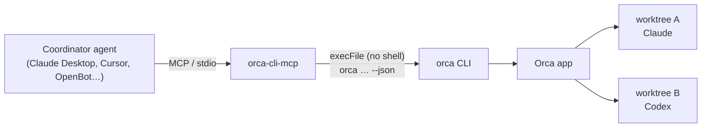

<div align="center">

# orca-cli-mcp

**Let any MCP-capable AI agent drive [Orca](https://github.com/stablyai/orca): spin up worktrees, launch Claude or Codex, read and answer their terminals, and track the work.**

[](https://github.com/Adryanrr/orca-cli-mcp/actions/workflows/ci.yml)


English · [Português](README.pt-BR.md)

</div>

---

## Why

Orca is great at running many coding agents side by side, each in its own git worktree. But the one thing that *coordinates* that work is usually you, clicking between tabs.

`orca-cli-mcp` turns Orca into a set of MCP tools, so a **coordinator agent** (Claude Desktop, Claude Code, Cursor, Codex, OpenBot, or anything that speaks MCP) can do it for you:

> *"Create a worktree for the login bug in `api`, start Claude there with the issue description, and tell me when it's done."*

The coordinator calls `orca_worktree_create`, then `orca_terminal_wait`, then `orca_terminal_read`, and reports back. You review the diff.

## How it works



It is a thin, auditable layer (~600 lines) over the **official `orca` CLI**. It never talks to Orca's internals, so it keeps working as Orca evolves, and every action is something you could have typed yourself.

## Features

- **18 curated tools**: 11 read tools and 7 actions. See the [tool list](#tools).
- **Safe by construction**:
  - Uses `execFile` with no shell.
  - Every value is passed as `--flag=value`, so text starting with `-` can never become another flag.
  - Inputs are validated with zod.
  - Child processes get a minimal environment.
- **No destructive commands**: it cannot remove worktrees or close terminals.
- **Honest failures**: a timeout is reported as *outcome unknown, check state before retrying*, so agents don't create duplicate worktrees or agents.
- **Token-friendly**: list outputs are compacted, responses are capped at 60k characters, and errors at 4k.
- **Cancellable**: when the MCP client cancels a request, the `orca` process is stopped.

## Requirements

- [Orca](https://github.com/stablyai/orca) installed and **running**. Check with `orca status`.
- The `orca` CLI. On macOS it ships inside the app at `/Applications/Orca.app/Contents/Resources/bin/orca`, and `orca-cli-mcp` finds it automatically (also at `/usr/local/bin/orca`). Elsewhere, put `orca` on your `PATH` or set `ORCA_BIN`.
- Node.js 20 or newer.

> Tested on macOS with Orca 1.4.x. Linux and Windows should work when `orca` is on `PATH`, but they are untested. Reports are welcome.

## Quick start

No npm publish needed: `npx` can install straight from GitHub. It builds once on install.

### Claude Code

```bash
claude mcp add orca -- npx -y github:Adryanrr/orca-cli-mcp
```

### Claude Desktop / Cursor

Add this to `claude_desktop_config.json` (Claude Desktop) or `.cursor/mcp.json` (Cursor):

```json
{
  "mcpServers": {
    "orca": {
      "command": "npx",
      "args": ["-y", "github:Adryanrr/orca-cli-mcp"]
    }
  }
}
```

### Codex

```toml
# ~/.codex/config.toml
[mcp_servers.orca]
command = "npx"
args = ["-y", "github:Adryanrr/orca-cli-mcp"]
```

### OpenBot

Add a **stdio** server in *Server settings → MCP*, with command `npx` and arguments `-y github:Adryanrr/orca-cli-mcp`. Every agent on the server gets the tools.

### From source

```bash
git clone https://github.com/Adryanrr/orca-cli-mcp.git
cd orca-cli-mcp
npm install        # also builds dist/
node dist/server.js
```

Then point your client to `node /absolute/path/to/orca-cli-mcp/dist/server.js`.

## Tools

| Tool | Kind | What it does |
|---|---|---|
| `orca_status` | read | Is the Orca app/runtime running and reachable? |
| `orca_repo_list` | read | Repos registered in Orca |
| `orca_project_list` | read | Durable Orca projects |
| `orca_worktree_list` | read | Worktrees with branch, path, linked PR/issue |
| `orca_worktree_show` | read | Full details of one worktree |
| `orca_worktree_ps` | read | Which agents run where, and their state |
| `orca_terminal_list` | read | Live terminals and agent sessions (handles) |
| `orca_terminal_read` | read | Bounded output, incremental with `cursor`, or the rendered `screen` |
| `orca_terminal_wait` | read | Wait for `exit` or `tui-idle` (agent finished its turn), max 55 s per call |
| `orca_task_list` | read | Orchestration tasks |
| `orca_inbox` | read | Orchestration messages between agents |
| `orca_automation_list` | read | Scheduled Orca automations |
| `orca_search` | read | Full-text search over agent session transcripts |
| `orca_worktree_create` | action | New worktree, optionally starting an agent with a prompt |
| `orca_agent_launch` | action | Start Claude, Codex, … in an existing worktree |
| `orca_terminal_create` | action | Open a terminal in a worktree |
| `orca_terminal_send` | action | Type into a terminal or agent session (`enter`, `interrupt`) |
| `orca_automation_run` | action | Run an automation now |

Worktree selectors accept `id:<repo-id>::<path>`, `path:<absolute-path>`, `name:<display-name>`, `branch:<branch>` and `issue:<number>`.

### Example prompts

- *"What's running in Orca right now? Summarize each agent's status."*
- *"In `api`, create a worktree `fix/login-timeout` from `main` and launch Claude with: fix the session timeout bug, add a regression test."*
- *"Wait for the agent in `fix/login-timeout` to finish, then show me the last 50 lines of its output."*
- *"The Codex agent in `feat/export` is asking a question. Read it and answer 'use CSV'."*

## Trust model (read this)

Whoever gets these tools can make your machine run code:

- `orca_terminal_send` in a shell terminal executes the text as a command.
- `orca_agent_launch` and `orca_worktree_create` start coding agents with the prompt you pass.

That is the point of the tool, but it means you should only connect it to agents you would trust with your terminal.

Mitigations built in:

- **Confirmation hints**: every action tool is annotated `destructiveHint: true`, so clients that support it ask you before running it.
- **Arbitrary commands are off by default**: `command` on `orca_terminal_create` and `setup: "run"` on `orca_worktree_create` require `ORCA_MCP_ALLOW_EXEC=1`.
- **Untrusted output**: `orca_terminal_read`, `orca_inbox` and `orca_search` return text from other sessions. Their descriptions tell the model to treat it as data, never as instructions. Prompt injection through terminal output is a real risk in any agent-to-agent setup.
- **Strict inputs**: branch names, agent ids and model ids are restricted to safe characters, and unknown fields are rejected.

## Configuration

| Variable | Default | Purpose |
|---|---|---|
| `ORCA_BIN` | `/usr/local/bin/orca`, then the binary inside `Orca.app`, then `orca` on `PATH` | Path to the orca CLI |
| `ORCA_TIMEOUT_MS` | `60000` (max `600000`) | Per-call timeout. Worktree creation and agent launch use 180 s; waits use their own timeout + 15 s |
| `ORCA_MCP_ALLOW_EXEC` | off | Set to `1` to allow arbitrary commands (see the [trust model](#trust-model-read-this)) |

## Troubleshooting

| Error | Meaning |
|---|---|
| `orca_unavailable` | The `orca` binary couldn't start. Install Orca or set `ORCA_BIN`. |
| `orca_timeout` | The command ran too long and its outcome is unknown. List worktrees and terminals before retrying. |
| `selector_not_found` | Wrong worktree selector. The error lists valid forms; use `orca_worktree_list`. |
| Runtime not reachable | Open the Orca app (`orca open`) and check `orca status`. |

## Development

```bash
npm install
npm test               # 50 tests (unit + integration against a fake orca binary)
npm run test:coverage
npm run typecheck
npm run smoke          # read-only calls against your real Orca
```

The project is small on purpose. `src/tools.ts` is the single place where tools are defined. To add one, add a spec there with a zod schema, then add a test.

## Disclaimer

This is an independent community project. It is **not affiliated with or endorsed by Stably AI**, the makers of Orca. "Orca" is used only to describe compatibility.

## License

[MIT](LICENSE) © Adryanrr
