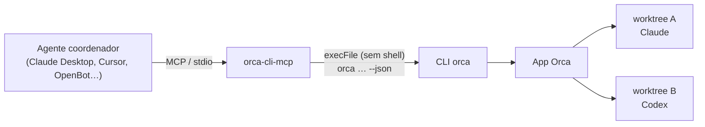

<div align="center">

# orca-cli-mcp

**Deixe qualquer agente de IA compatível com MCP controlar o [Orca](https://github.com/stablyai/orca): criar worktrees, lançar Claude ou Codex, ler e responder os terminais deles e acompanhar o trabalho.**

[](https://github.com/Adryanrr/orca-cli-mcp/actions/workflows/ci.yml)
[](https://www.npmjs.com/package/orca-cli-mcp)


[English](README.md) · Português

</div>

---

## Por quê

O Orca é ótimo para rodar vários agentes de código lado a lado, cada um na sua worktree do git. Mas quem *coordena* esse trabalho costuma ser você, pulando entre abas.

O `orca-cli-mcp` transforma o Orca num conjunto de ferramentas MCP, para que um **agente coordenador** faça isso por você. Pode ser o Claude Desktop, o Claude Code, o Cursor, o Codex, o OpenBot ou qualquer cliente MCP:

> *"Crie uma worktree para o bug de login no `api`, abra o Claude lá com a descrição da issue e me avise quando terminar."*

O coordenador chama `orca_worktree_create`, depois `orca_terminal_wait` e `orca_terminal_read`, e te dá o retorno. Você revisa o diff.

## Como funciona



É uma camada fina e auditável (~600 linhas) sobre a **CLI oficial `orca`**. Ela não mexe nas partes internas do Orca, então continua funcionando quando o Orca muda. Toda ação é algo que você poderia ter digitado no terminal.

## Recursos

- **18 ferramentas selecionadas**: 11 de leitura e 7 de ação. Veja a [lista de ferramentas](#ferramentas).
- **Segura por construção**:
  - Usa `execFile`, sem shell.
  - Todo valor vai como `--flag=valor`, então um texto que começa com `-` nunca vira outra flag.
  - As entradas são validadas com zod.
  - Os processos filhos recebem um ambiente mínimo.
- **Sem comandos destrutivos**: não remove worktrees nem fecha terminais.
- **Falhas honestas**: um timeout aparece como *resultado desconhecido, confira o estado antes de repetir*. Assim os agentes não criam worktrees ou agentes duplicados.
- **Econômica em tokens**: as listas vêm compactadas, as respostas têm no máximo 60 mil caracteres e os erros, no máximo 4 mil.
- **Cancelável**: se o cliente MCP cancelar o pedido, o processo `orca` é encerrado.

## Requisitos

- [Orca](https://github.com/stablyai/orca) instalado e **aberto**. Confira com `orca status`.
- A CLI `orca`. No macOS ela vem dentro do app, em `/Applications/Orca.app/Contents/Resources/bin/orca`, e o `orca-cli-mcp` a encontra sozinho (também em `/usr/local/bin/orca`). Em outros sistemas, coloque `orca` no `PATH` ou defina `ORCA_BIN`.
- Node.js 20 ou mais novo.

> Testado no macOS com o Orca 1.4.x. Linux e Windows devem funcionar com `orca` no `PATH`, mas ainda não foram testados. Relatos são bem-vindos.

## Começo rápido

Rode com `npx`, sem passo de instalação. Para usar o último commit em vez da versão do npm, troque `orca-cli-mcp` por `github:Adryanrr/orca-cli-mcp`.

### Claude Code

```bash
claude mcp add orca -- npx -y orca-cli-mcp
```

### Claude Desktop / Cursor

Adicione em `claude_desktop_config.json` (Claude Desktop) ou em `.cursor/mcp.json` (Cursor):

```json
{
  "mcpServers": {
    "orca": {
      "command": "npx",
      "args": ["-y", "orca-cli-mcp"]
    }
  }
}
```

### Codex

```toml
# ~/.codex/config.toml
[mcp_servers.orca]
command = "npx"
args = ["-y", "orca-cli-mcp"]
```

### OpenBot

Em *Server settings → MCP*, adicione um servidor **stdio** com o comando `npx` e os argumentos `-y orca-cli-mcp`. Todos os agentes do servidor recebem as ferramentas.

### A partir do código

```bash
git clone https://github.com/Adryanrr/orca-cli-mcp.git
cd orca-cli-mcp
npm install        # também gera dist/
node dist/server.js
```

Depois aponte o cliente para `node /caminho/absoluto/orca-cli-mcp/dist/server.js`.

## Ferramentas

| Ferramenta | Tipo | O que faz |
|---|---|---|
| `orca_status` | leitura | O app e o runtime do Orca estão abertos e acessíveis? |
| `orca_repo_list` | leitura | Repos cadastrados no Orca |
| `orca_project_list` | leitura | Projetos do Orca |
| `orca_worktree_list` | leitura | Worktrees com branch, caminho e PR ou issue vinculados |
| `orca_worktree_show` | leitura | Detalhes de uma worktree |
| `orca_worktree_ps` | leitura | Quais agentes rodam onde, e o estado de cada um |
| `orca_terminal_list` | leitura | Terminais e sessões de agentes ativos (handles) |
| `orca_terminal_read` | leitura | Saída limitada, incremental com `cursor`, ou a tela renderizada com `screen` |
| `orca_terminal_wait` | leitura | Espera `exit` ou `tui-idle` (o agente terminou o turno), até 55 s por chamada |
| `orca_task_list` | leitura | Tarefas de orquestração |
| `orca_inbox` | leitura | Mensagens de orquestração entre agentes |
| `orca_automation_list` | leitura | Automações agendadas no Orca |
| `orca_search` | leitura | Busca de texto nas conversas dos agentes |
| `orca_worktree_create` | ação | Cria uma worktree, opcionalmente já com um agente e um prompt |
| `orca_agent_launch` | ação | Inicia Claude, Codex etc. numa worktree existente |
| `orca_terminal_create` | ação | Abre um terminal numa worktree |
| `orca_terminal_send` | ação | Digita num terminal ou sessão de agente (`enter`, `interrupt`) |
| `orca_automation_run` | ação | Roda uma automação agora |

Os seletores de worktree aceitam `id:<repo-id>::<caminho>`, `path:<caminho-absoluto>`, `name:<nome>`, `branch:<branch>` e `issue:<número>`.

### Exemplos de pedidos

- *"O que está rodando no Orca agora? Resuma o status de cada agente."*
- *"No `api`, crie a worktree `fix/login-timeout` a partir da `main` e lance o Claude com: corrija o bug de timeout da sessão e adicione um teste de regressão."*
- *"Espere o agente da `fix/login-timeout` terminar e me mostre as últimas 50 linhas da saída."*
- *"O Codex da `feat/export` está fazendo uma pergunta. Leia e responda 'use CSV'."*

## Modelo de confiança (leia isto)

Quem recebe estas ferramentas consegue fazer a sua máquina executar código:

- `orca_terminal_send`, num terminal de shell, executa o texto como comando.
- `orca_agent_launch` e `orca_worktree_create` iniciam agentes de código com o prompt que você passar.

É para isso que a ferramenta existe, mas conecte-a só a agentes em quem você confiaria o seu terminal.

Proteções embutidas:

- **Pedido de confirmação**: toda ferramenta de ação vem marcada com `destructiveHint: true`, então os clientes que suportam isso pedem confirmação antes de rodar.
- **Comandos arbitrários desligados por padrão**: `command` no `orca_terminal_create` e `setup: "run"` no `orca_worktree_create` exigem `ORCA_MCP_ALLOW_EXEC=1`.
- **Saída não confiável**: `orca_terminal_read`, `orca_inbox` e `orca_search` devolvem texto de outras sessões. A descrição dessas ferramentas manda o modelo tratar esse texto como dado, nunca como instrução. Injeção de prompt pela saída de um terminal é um risco real em qualquer arranjo de agente coordenando agente.
- **Entradas restritas**: nomes de branch, ids de agente e ids de modelo só aceitam caracteres seguros, e campos desconhecidos são recusados.

## Configuração

| Variável | Padrão | Uso |
|---|---|---|
| `ORCA_BIN` | `/usr/local/bin/orca`, depois o binário dentro do `Orca.app`, depois `orca` no `PATH` | Caminho da CLI |
| `ORCA_TIMEOUT_MS` | `60000` (máx. `600000`) | Timeout por chamada. Criar worktree e lançar agente usam 180 s; as esperas usam o próprio timeout + 15 s |
| `ORCA_MCP_ALLOW_EXEC` | desligado | `1` libera comandos arbitrários (veja o [modelo de confiança](#modelo-de-confiança-leia-isto)) |

## Solução de problemas

| Erro | Significado |
|---|---|
| `orca_unavailable` | O binário `orca` não iniciou. Instale o Orca ou defina `ORCA_BIN`. |
| `orca_timeout` | O comando demorou demais e o resultado é desconhecido. Liste worktrees e terminais antes de repetir. |
| `selector_not_found` | Seletor de worktree errado. O erro mostra os formatos válidos; use `orca_worktree_list`. |
| Runtime inacessível | Abra o app do Orca (`orca open`) e confira com `orca status`. |

## Desenvolvimento

```bash
npm install
npm test               # 50 testes (unitários + integração com um orca falso)
npm run test:coverage
npm run typecheck
npm run smoke          # chamadas só de leitura contra o seu Orca real
```

O projeto é pequeno de propósito. As ferramentas ficam todas definidas em `src/tools.ts`. Para criar uma nova, adicione a especificação lá, com o esquema zod, e um teste.

## Aviso

Este é um projeto independente da comunidade. **Não tem vínculo com a Stably AI** (criadora do Orca) nem aval dela. O nome "Orca" aparece só para indicar compatibilidade.

## Licença

[MIT](LICENSE) © Adryanrr
